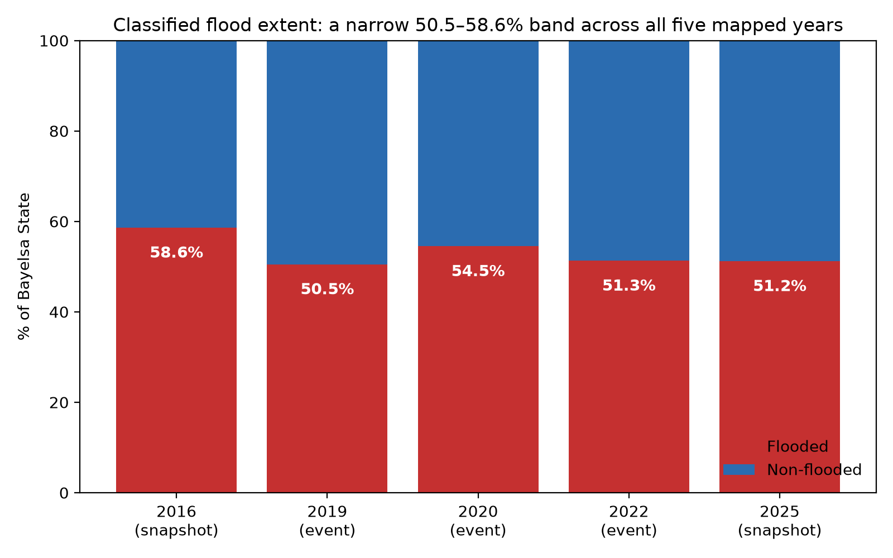
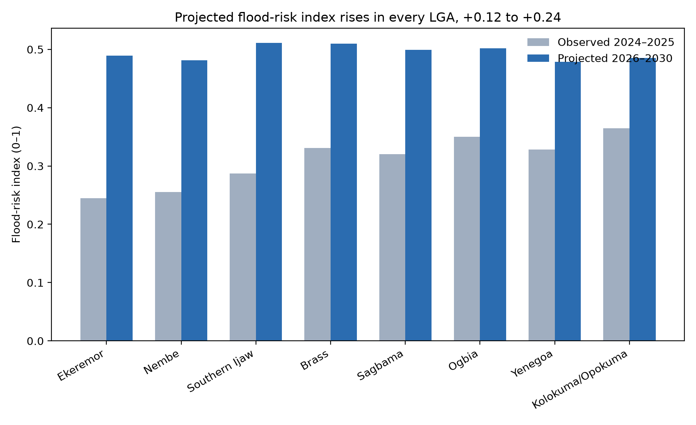

# 2026–2030 Flood Forecast: Comparison Report

As of 2026-09-30.

The downscaled 2026–2030 pixel-level forecast projects a statewide mean flood-risk index of 0.70, up from the observed 2015–2025 mean of 0.51 across Bayelsa State. This is a uniform projected shift rather than a newly detected spatial pattern: every LGA's risk index rises by construction, carried forward from the zonal LSTM baseline (see `PAPER_DRAFT.md` §3.6, §4.4).

## Statewide summary

| Metric | Observed (2015–2025) | Projected (2026–2030) |
| --- | --- | --- |
| Mean flood frequency / risk index | 0.515 | 0.705 |
| Median | 0.500 | 0.698 |
| Max | 0.886 | 1.000 (clipped) |
| Share of pixels at the 1.0 ceiling | — | 12.1% |
| Basis | Wet-season SAR classification, 44 months | Zonal LSTM baseline, downscaled to pixel level |

The projected column is not an independently modeled pixel forecast — it is each pixel's observed frequency shifted upward by its LGA's projected change in flood-risk index. Ceiling pixels concentrate in the LGAs with the largest projected increases (Nembe, Ekeremor, Brass), not randomly.

## By year: flooded vs. non-flooded

| Year | Flooded | Non-flooded | Type |
| --- | --- | --- | --- |
| 2016 | 58.6% | 41.4% | Wet-season snapshot (substitute for 2015) |
| 2019 | 50.5% | 49.5% | Documented flood event |
| 2020 | 54.5% | 45.5% | Documented flood event |
| 2022 | 51.3% | 48.7% | Documented flood event |
| 2025 | 51.2% | 48.8% | Wet-season snapshot |

Classified flood extent sits in a narrow 50.5–58.6% band across all five mapped years, and the three NEMA-documented disaster years (2019, 2020, 2022: 50.5–54.5%) do not stand out clearly above the two non-disaster snapshot years (2016, 2025: 51.2–58.6%). This is a known limitation, not a contradiction: the classifier still cannot fully separate genuine transient flooding from chronically wet swamp/mangrove forest that looks flood-like in SAR year-round (`PAPER_DRAFT.md` §3.3, §5.3).

## By LGA: observed vs. projected flood-risk index

| LGA | Observed 2024–2025 | Projected 2026–2030 | Δ |
| --- | --- | --- | --- |
| Ekeremor | 0.245 | 0.489 | +0.244 |
| Nembe | 0.255 | 0.481 | +0.226 |
| Southern Ijaw | 0.287 | 0.511 | +0.224 |
| Brass | 0.331 | 0.510 | +0.179 |
| Sagbama | 0.320 | 0.499 | +0.179 |
| Ogbia | 0.350 | 0.502 | +0.152 |
| Yenegoa | 0.328 | 0.479 | +0.151 |
| Kolokuma/Opokuma | 0.365 | 0.485 | +0.120 |

Every LGA's projected 2026–2030 risk index sits above its observed 2024–2025 value, by 0.12 (Kolokuma/Opokuma) to 0.24 (Ekeremor) — a uniform shift from the flat zonal LSTM baseline, not evidence of elevated risk specific to any one place.

## Method note

The 2026–2030 pixel-level map is a **statistical downscaling** (additive delta) of the zonal LSTM baseline, not an independently trained per-pixel model: `pixel_forecast = flood_frequency + (risk_index_2026_2030[LGA] − risk_index_2024_2025[LGA])`, clipped to [0,1]. A first attempt used a multiplicative ratio and was rejected — it pushed 35.7% of pixels past the ceiling. See `PROJECT_PLAN.md` and `PAPER_DRAFT.md` §3.6 for full detail, including the baseline's flat "no further climate/land-use trend" assumption.

*Sources: `outputs/geotiffs/bayelsa_{year}_flood_extent.tif`, `outputs/geotiffs/bayelsa_wetseason_flood_frequency_2015_2025.tif`, `outputs/geotiffs/bayelsa_pixel_forecast_2026_2030.tif`, `data/aoi/bayelsa_lgas_lstm_risk.geojson`.*
