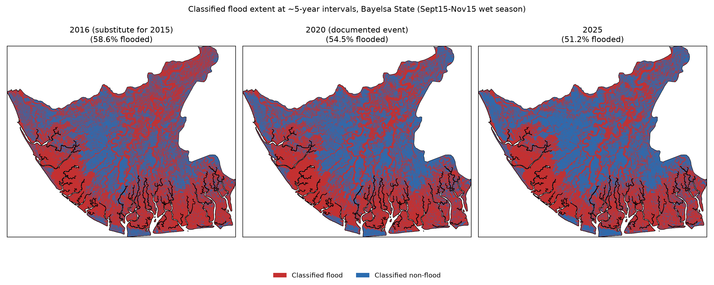
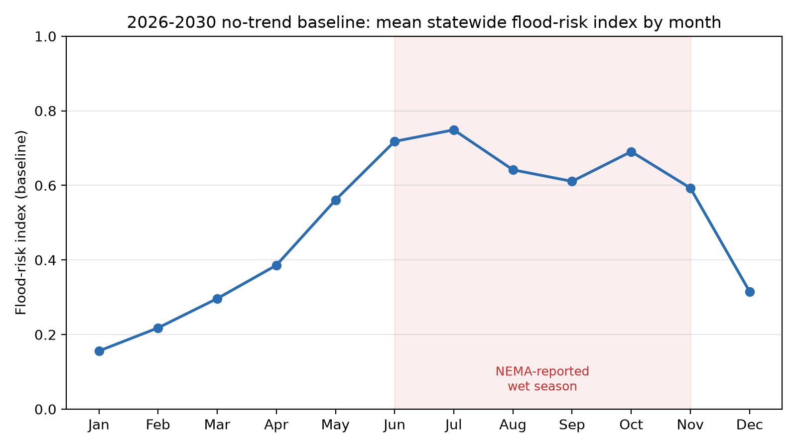
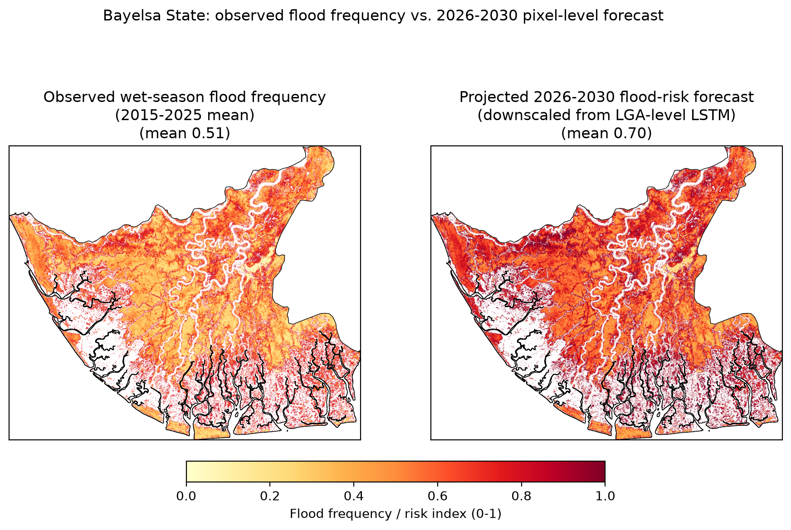

**Status: first full draft. Methodological citations (Lee 1980, Twele et al. 2016, Hess/Melack Amazon flooded-forest SAR) and the Lagdo Dam claim were verified against publisher/DOI records and news sources — full bibliographic details are in the References section. Facts attributed to NEMA/media reporting are sourced from the specific URLs listed in the References section and were verified via web search during this project, not fabricated. Update (2026-08-14): per-event classified flood-extent rasters now exist for all three flood years (Section 4.2), and the LGA-level disaster-record cross-check and Objective 5 priority ranking (Sections 3.7, 3.9, 4.6, 5.4) were recomputed with the SAR-persistent-wetland mask properly applied, materially changing the top-priority LGA ranking (now Yenagoa > Brass > Kolokuma/Opokuma, previously Southern Ijaw > Brass > Yenagoa) — see Section 3.7 for why the correction matters. Also added: the June/July LSTM seasonal anomaly was resolved as a model artifact, not a real signal (Sections 4.4, 5.3); a pixel-level population-weighted embankment-corridor ranking (Section 4.6, Table 6); and a stable 2026–2030 no-trend baseline framed against SDG 2030 targets (Sections 3.6, 4.4, 5.5). Update (2026-08-16): added Cohen's κ for the RF classifier (0.493 held-out, 0.221 vs. Sentinel-2, Sections 3.4/3.7/4.5), an explicit spatial view of the LSTM risk index by LGA (Figure 6, Section 4.4), and a 5-year-interval classified-extent comparison, 2016/2020/2025 (Figure 2c, Section 4.2) — 2016 substitutes for an unreliable 2015 (early-Sentinel-1-mission data issue, not a real flood).**

---

## Abstract

Bayelsa State, in Nigeria's Niger Delta, is among the most flood-exposed regions in West Africa, with severe flood events in 2012, 2019, 2020, and 2022 displacing hundreds of thousands of residents. Persistent cloud cover during the flood-prone wet season limits the utility of optical satellite imagery for monitoring, motivating an all-weather synthetic aperture radar (SAR) approach. This study develops an integrated Sentinel-1 SAR and machine learning framework to map recurrent flood inundation patterns and forecast near-term flood risk trends across Bayelsa State. Multi-temporal Sentinel-1 GRD imagery (2015–2025) was preprocessed on Google Earth Engine using a Refined Lee speckle filter, and a Random Forest classifier was trained on VV/VH backscatter, GLCM texture, and terrain features to discriminate flood from non-flood surfaces. Critically, validation revealed that flooded mangrove/swamp forest — which dominates Bayelsa's land cover — produces an *increase* in backscatter via double-bounce scattering, opposite to the classical open-water specular decrease; this finding shaped both the classification feature design and the definition of "chronic flood risk" used throughout the study. A wet-season inundation frequency map (2015–2025) was produced, and a Long Short-Term Memory (LSTM) network was trained on zonal SAR and rainfall time series to forecast near-term flood-risk trends per local government area (LGA). Independent validation against Sentinel-2 NDWI showed 98% recall for open water. The resulting products were synthesized with population data to produce an LGA-level priority ranking and pixel-level embankment-corridor siting analysis for disaster risk reduction planning, and a stable 2026–2030 no-trend baseline was constructed to frame these findings against the 2030 targets of Sustainable Development Goals 1, 11, and 13.

---

## 1. Introduction

### 1.1 Background

Flooding is among the most recurrent and damaging natural hazards in Nigeria's Niger Delta, driven by the region's low-lying deltaic topography, extensive river and creek network, and heavy seasonal rainfall compounded by upstream river discharge — including, in some years, water releases from the Lagdo Dam in Cameroon [Vanguard, 2024]. Bayelsa State, situated at the heart of the Niger Delta, has experienced a series of severe flood disasters in the past decade: flooding beginning in June 2019 and peaking in late September displaced approximately 700,000 people in the state [ACAPS/ReliefWeb, 2019]; a further flood event in September–October 2020 caused localized fatalities and displacement [FloodList, 2020]; and the September–November 2022 flood — Nigeria's worst in a decade — displaced an estimated 1.3 million people in Bayelsa alone, the worst-affected state in the country [NEMA, 2022; Vanguard, 2022].

### 1.2 Rationale for SAR-based monitoring

Optical satellite sensors, while intuitive for visual flood interpretation, are frequently unusable during the Niger Delta's wet season due to persistent cloud cover — a constraint confirmed during this study's own search for cloud-free Sentinel-2 imagery, where scenes with under 20% cloud cover during the September–November 2022 flood window were the exception rather than the rule (Section 3.5). Synthetic aperture radar (SAR), by contrast, penetrates cloud cover and operates independently of solar illumination, making it the sensor of choice for operational flood monitoring in tropical, cloud-prone environments [Twele et al., 2016]. The Copernicus Sentinel-1 mission's C-band SAR, freely available since 2014–2015 with regular revisit, provides the multi-temporal archive depth needed for both historical flood-frequency mapping and time-series-based forecasting.

### 1.3 Objectives

This study pursues five objectives:
1. Process multi-temporal Sentinel-1 SAR imagery on Google Earth Engine for consistent, all-weather flood detection across Bayelsa State.
2. Apply a Random Forest classifier to multi-temporal SAR backscatter composites to discriminate flood from non-flood surfaces and produce an inundation frequency map identifying chronically flood-affected zones.
3. Develop and train a Long Short-Term Memory (LSTM) model on historical SAR and rainfall time series to forecast near-term flood-risk trends.
4. Validate classification and prediction outputs against independent Sentinel-2 optical data and disaster-agency (NEMA/SEMA) reporting.
5. Synthesize the resulting geospatial intelligence, combined with population exposure data, into actionable recommendations for flood-break embankment placement and disaster risk reduction planning.

---

## 2. Study Area

Bayelsa State (total land area ≈ 9,807 km², computed from the state boundary polygon used in this study) lies within the central Niger Delta, Nigeria, bounded approximately by longitudes 5.38°E–6.72°E and latitudes 4.27°N–5.39°N. The state comprises eight local government areas (LGAs): Yenagoa (the state capital), Kolokuma/Opokuma, Ogbia, Brass, Nembe, Sagbama, Ekeremor, and Southern Ijaw. The terrain is characteristically low-lying (mean elevation in this study's analysis ≈ 4.3 m) and dominated by freshwater swamp forest, mangrove forest, and an extensive network of rivers, creeks, and tidal channels — a land cover composition that, as this study demonstrates (Section 4.1), has direct methodological consequences for SAR-based flood detection. Population is concentrated in Yenagoa (WorldPop 2020 estimate: 471,073, by far the highest of the eight LGAs used in this study) and Southern Ijaw (428,499), with the remaining LGAs considerably less densely populated (range: 106,130–359,065).

---

## 3. Materials and Methods

### 3.1 Data sources

| Dataset | Source | Use |
|---|---|---|
| Sentinel-1 GRD (IW, VV+VH) | Copernicus/ESA via Google Earth Engine (`COPERNICUS/S1_GRD`) | Primary SAR observations, 2015-04 to 2026-07 |
| Sentinel-2 Surface Reflectance | Copernicus/ESA (`COPERNICUS/S2_SR_HARMONIZED`) | Independent optical validation |
| CHIRPS Daily Precipitation | UCSB Climate Hazards Group (`UCSB-CHG/CHIRPS/DAILY`) | Rainfall covariate for LSTM |
| MERIT DEM | `MERIT/DEM/v1_0_3` | Elevation, slope |
| JRC Global Surface Water | `JRC/GSW1_4/GlobalSurfaceWater` | Permanent water masking |
| WorldPop | `WorldPop/GP/100m/pop`, 2020 | Population exposure |
| FAO GAUL Level 2 | `FAO/GAUL/2015/level2` | LGA administrative boundaries |
| State boundary | GADM-derived shapefile (34-part MultiPolygon) | Study area definition |

### 3.2 Sentinel-1 SAR processing

**Track selection.** Sentinel-1 coverage of Bayelsa comes from four relative orbits (two ascending: 30, 103; two descending: 22, 124). Per-scene footprint analysis showed ascending orbit 103 provides 93.1% single-scene coverage of the state, and 100% coverage after mosaicking same-date tiles (two frames are required along-track); this orbit, with 329 distinct acquisition dates from April 2015 to the present, was used as the primary consistent-geometry track for all classification work, to avoid incidence-angle-related backscatter inconsistency across the time series.

**Speckle filtering.** A Refined Lee adaptive filter [Lee, 1980; as commonly implemented for operational SAR flood mapping] was applied to each daily mosaic in natural (linear) units. Filter validation on a representative scene showed a 2.6–3× reduction in local variance (VH: 6.45 → 2.39; VV: 7.48 → 2.83) with minimal mean bias (<0.3 dB), and edge-pixel loss of approximately 1.6% attributable to the filter's 7×7 window — confirming the filter suppresses speckle without introducing systematic bias or unexpected interior masking.

### 3.3 Flood-event composites and the double-bounce finding

Event-specific composites (median of despeckled daily mosaics) were generated for three documented flood years — 2019 (window: 15 Sept–15 Nov), 2020 (15 Sept–31 Oct), 2022 (15 Sept–15 Nov) — anchored on NEMA/media-reported flood timelines (Section 1.1), each paired with a dry-season baseline composite (15 Jan–15 Mar of the same year). Sentinel-1 does not cover the 2012 flood event (pre-dates the mission); 2012 is therefore used only as contextual/motivating background, not as SAR training data.

Comparing the 2022 event composite against its dry-season baseline, stratified by JRC water-occurrence class, revealed a land-cover-dependent, *bidirectional* backscatter response to flooding:

| Land cover class (n sampled pixels) | Event VH / VV (dB) | Baseline VH / VV (dB) | Δ |
|---|---|---|---|
| Seasonal water (n≈38,150) | −16.56 / −9.38 | −16.59 / −9.35 | ≈0 |
| Permanent water (n≈14,021) | −21.89 / −14.94 | −21.72 / −14.93 | ≈0 |
| **Never-water / upland-forest (n≈890,706)** | **−13.82 / −6.79** | **−14.18 / −7.15** | **+0.36 dB (both pols.)** |

The dominant land cover class — upland/forest pixels never classified as water in the multi-decadal JRC record, comprising roughly 94% of the sampled area — showed a backscatter *increase* during the flood event, the classical signature of double-bounce scattering between a flooded surface and vertical vegetation structure (flooded mangrove/swamp forest), rather than the specular decrease associated with open-water flooding. This finding, to the authors' knowledge not previously quantified for Bayelsa specifically, has two direct methodological consequences addressed in this study: (1) a simple low-backscatter threshold is insufficient for flood detection in this environment, motivating the multi-feature Random Forest approach (Section 3.4); and (2) distinguishing genuinely episodic flooding from perennially wet swamp forest that structurally resembles "flood" in every SAR observation requires an explicit wetland-exclusion step (Section 3.6).

### 3.4 Feature engineering and Random Forest classification

**Feature stack.** VV, VH, VH−VV (dB difference), three GLCM texture measures (contrast, inverse difference moment/homogeneity, entropy; computed on a byte-rescaled VV band, 7×7 window), and terrain slope (from MERIT DEM).

**Training labels.** In the absence of a manual digitizing capability, training labels were generated semi-automatically from the event-vs-baseline VH anomaly, using asymmetric percentile thresholds (5th percentile for open-water/specular decrease, 90th percentile for flooded-vegetation/double-bounce increase — asymmetric because the anomaly distribution is right-skewed given the double-bounce dominance described above), constrained to elevation ≤10 m and river distance ≤2 km for flood-plausible pixels, and river distance ≥3 km for high-confidence non-flood pixels. Ambiguous mid-range-anomaly pixels were excluded from training rather than force-labeled. Stratified samples (~300–1,800 points, balanced by class) were pooled across the three flood-event years.

**Feature leakage check.** An initial model that included elevation and river-distance as classifier *features* (in addition to their role as label-generation constraints) achieved a spurious 100% resubstitution accuracy, with 76% of feature importance on river-distance alone — the model had learned to reproduce the labeling heuristic rather than a genuine SAR signature. These two variables were excluded from the final feature set, which uses only VV, VH, VH−VV, the three GLCM bands, and slope.

**Classifier.** A Random Forest (200 trees) was trained via both `scikit-learn` (for held-out evaluation) and Earth Engine's `smileRandomForest` (for server-side classification of full images). On a 70/30 held-out split (n=1,800 pooled samples across 2019/2020/2022), the corrected model achieved **74.6% accuracy (Cohen's κ = 0.493, "moderate" agreement)**, with feature importance well-distributed across VH (16.8%), VV (16.8%), VV-contrast (16.3%), VV-IDM (13.6%), slope (12.5%), VV-entropy (12.4%), and VH−VV (11.6%) — no single feature dominating, consistent with a genuine multi-feature SAR signature rather than a shortcut.

### 3.5 Inundation frequency mapping

To characterize chronic flood risk rather than single-event extent, the trained classifier was applied to wet-season (August–November) monthly composites for every year 2015–2025 (44 composites total; confirmed to have 2–3 Sentinel-1 acquisition dates in every month, with no data gaps). The resulting 44 binary classifications were averaged per pixel to produce a wet-season inundation frequency layer.

**Wetland-exclusion masking.** An unmasked version of this frequency layer showed the 95th and 99th percentiles saturated at exactly 1.0 — i.e., some pixels were classified "flood" in literally every sampled wet-season month across 11 independent years, which cannot represent genuine episodic flooding (documented flood events are tied to specific years, not every wet season for a decade). Two exclusion layers were applied in sequence: (1) JRC-derived permanent open water (occurrence ≥50%, covering 6.2% of the state area); and (2) a SAR-derived "persistent wetland" layer — pixels still classified "flood" in ≥90% of the 44 sampled months even after JRC masking (covering a further 16.3% of the state), capturing the flooded/swamp-forest signature that JRC's optical-based water detection cannot see under canopy. This SAR-derived exclusion layer is conceptually the same temporal-consistency principle JRC itself uses to define "permanent" water, applied to SAR observations rather than optical ones, and is a post-classification filter on the finished time series rather than a retraining step. After both exclusions, the frequency distribution was well-behaved (no saturation; max 88.6%, mean 51.5%, median 50.0% in the final full-resolution product).

### 3.6 LSTM flood-risk forecasting

Given GEE compute constraints (Section 3.8), per-pixel classification across the full historical monthly record was judged too expensive to repeat for LSTM training data; a zonal (LGA-level) approach was used instead. For each of the eight LGAs and each month from 2015–2025 (132 months/zone; the first three months of 2015 excluded for lacking Sentinel-1 scenes on this orbit), zonal-mean raw VV/VH backscatter (undespeckled — spatial averaging over each zone's many pixels provides its own speckle suppression) and CHIRPS monthly rainfall totals were extracted (1,056 zone-months total).

A single-layer LSTM (32 units) with a dense output head was trained to forecast next-month zonal VH from a 6-month lookback window of [VV, VH, rainfall]. VH was chosen as the target since both the open-water decrease and flooded-vegetation increase manifest most clearly in VH (Section 3.3). Training used a strictly chronological split (train: 2015–2023, n=792 sequences; test: 2024–2025, n=192 sequences) to avoid leaking future information, with feature/target scalers fit on the training period only.

This design predicts a continuous zone-level backscatter/flood-risk-trend signal rather than a classified per-pixel flood-extent map — a deliberate scoping decision made to keep the LSTM component tractable under compute constraints, not an unstated simplification.

**Flood-risk interpretation.** To translate the raw VH forecast into an interpretable risk indicator, each forecast was expressed as its percentile rank within the corresponding zone's own training-period VH distribution (using the full ~105-month history per zone rather than the much smaller sample of known-flood-month observations, which proved too noise-sensitive in an initial version — see Section 5.3).

**2026–2030 baseline projection.** To connect the forecasting component to the 2030 target year used throughout the UN Sustainable Development Goals (Section 5.5), the model was extended beyond its 2024–2025 test period. A first attempt fed each month's own forecast recursively back in as the next month's VH input — this compounded: for the identical July climatological input in every year, predicted VH rose monotonically from −14.20 dB (2026) to −13.93 dB (2030) with no external driver to explain it, a known recursive-forecast drift artifact rather than a genuine trend, and was discarded. The reported baseline instead removes the recursion entirely: each future month's 6-month lookback window is built solely from that zone's own historical (2015–2025) per-calendar-month climatology for all three input features, never from a prior model prediction. Because the same lookback recurs identically every year for a given calendar month, the model's output for that month is identical every year by construction (verified directly: July's predicted VH is −14.116 dB in every year 2026–2030, exactly) — a flat, non-drifting **no-trend baseline**, not a genuine forecast of what 2030 will actually look like. It deliberately excludes climate-change-driven rainfall intensification, sea-level rise, and land-use change, all material for the Niger Delta specifically (Section 5.5). Its purpose is to serve as a reference line: any real future change, or the effect of this study's own recommended interventions (Section 4.6), would appear as a departure from it, not as a feature of it.

**Pixel-level downscaling of the 2026–2030 baseline.** The zonal LSTM output has no native per-pixel form; to give the 2026–2030 baseline explicit spatial resolution without re-incurring the per-pixel compute cost that motivated the zonal design in the first place (Section 3.8), it was downscaled statistically rather than re-modeled independently at pixel level. Each pixel's observed wet-season flood frequency (Section 3.5) was shifted by its LGA's projected absolute change in risk index between the 2024–2025 test period and the 2026–2030 baseline: `pixel_forecast = flood_frequency + (risk_index_2026_2030[LGA] − risk_index_2024_2025[LGA])`, clipped to [0,1]. An initial version used a multiplicative ratio instead of an additive shift and was rejected: since flood frequency is a bounded [0,1] proportion already averaging 0.515, multiplying by the per-LGA scale factors (1.3×–2.0×) pushed 35.7% of all pixels past the ceiling, disproportionately erasing spatial detail in the already flood-prone areas the map most needs to distinguish. The additive form — the standard choice for downscaling a bounded proportion, as opposed to an unbounded positive quantity like rainfall, where a multiplicative ratio is appropriate — reduced ceiling saturation to 12.1%; the remaining ceiling pixels were confirmed to be a genuine result of the projection rather than a residual artifact, averaging 0.85 base frequency already and concentrated in the LGAs with the largest projected increases (Nembe, Ekeremor, Brass) rather than distributed uniformly. This map is a **spatial disaggregation of the zonal forecast**, not an independent pixel-level prediction: it inherits the zonal baseline's flat, no-further-trend assumption (above) and additionally assumes each LGA's internal spatial flood pattern remains fixed while only its overall level shifts — it cannot represent a scenario where the flood-prone corridor itself relocates within an LGA.

### 3.7 Validation

**Sentinel-2 NDWI cross-check.** The 2022 event classification was compared against an independent open-water reference derived from Sentinel-2 (8-tile cloud-masked mosaic, 3 November 2022, 14.5% cloud cover on the least-cloudy constituent tile; SCL-band cloud/shadow masking), using the McFeeters NDWI water threshold (NDWI > 0). A stratified sample of 2,000 points (1,000 per S2 water/dry class) gave: 98.0% agreement where S2 detected open water (SAR recall); 24.1% agreement where S2 detected dry land (SAR frequently classifying "flood" where S2 saw no water). Overall agreement (Cohen's κ = 0.221, "fair") is substantially lower than the RF's own held-out κ (0.493, Section 3.4) — expected, not a sign of poor classification, since NDWI can only credit agreement on the open-water portion of the flood signal and structurally cannot see the flooded-vegetation double-bounce signature that this study's own findings (Section 3.3) show dominates the AOI; a low Kappa against an optical-only reference is the predicted consequence of that finding, not an independent problem with it. Visual inspection of five S2-dry/SAR-flood disagreement locations found all five to be dense forest/vegetation canopy, consistent with the double-bounce explanation (Section 3.3) rather than random classifier error, though one location showed evidence of residual cloud contamination not caught by the SCL mask, indicating the 76% disagreement figure is an approximate upper bound.

**Disaster-record cross-check.** Media/NEMA reporting named Yenagoa LGA as worst-hit in the 2022 flood (by population displaced). An initial zonal comparison, masking only JRC permanent water, placed Yenagoa fifth of eight by 2022 classification percentage (≈43%), with coastal/riverine Nembe (≈68%) and Brass (≈63%) ranking highest — apparently contradicting the disaster narrative. Reapplying the SAR-derived persistent-wetland mask (Section 3.5) to this LGA-level comparison, rather than JRC water alone, resolved most of the discrepancy directly: Nembe's and Brass's apparent dominance shrank sharply once their large areas of chronic swamp/wetland (54.3% and 50.9% of their respective areas) were properly excluded, while Yenagoa — only 16.7% chronic wetland — barely changed (43% → 34%). Under the fully masked comparison, Yenagoa's flood percentage (33.7%) is the third-highest of the eight LGAs and close to the top two (Nembe 38.5%, Kolokuma/Opokuma 36.2%), directly consistent with the disaster narrative rather than requiring population weighting alone to reconcile (Section 3.9 shows population weighting still matters, and reinforces this result further).

**Table 5. LGA-level 2022 flood classification %, JRC-only vs. JRC + SAR-persistent-wetland masked** (`outputs/tables/lga_zonal_check_2022_masked.csv`).

| LGA | Flood % (JRC-only) | Flood % (dual-masked) | % of LGA excluded as chronic wetland |
|---|---|---|---|
| Nembe | 67.5 | 38.5 | 54.3 |
| Brass | 62.5 | 32.1 | 50.9 |
| Southern Ijaw | 53.7 | 22.9 | 43.6 |
| Kolokuma/Opokuma | 50.0 | 36.2 | 28.1 |
| Ekeremor | 37.2 | 20.8 | 24.7 |
| Sagbama | 40.0 | 27.7 | 23.0 |
| Yenegoa | 42.8 | 33.7 | 16.7 |
| Ogbia | 28.7 | 19.4 | 14.1 |

The wetland-exclusion percentage tracks closely with how much each LGA's apparent flood percentage shrinks — Nembe and Brass, the two most swamp/mangrove-dominated LGAs, lose over half their nominal "flooded" area to the correction, while Yenegoa (the most urbanized LGA) loses comparatively little.

### 3.8 Computational infrastructure and constraints

All SAR/optical processing was performed in Python (`earthengine-api`, `geemap`) via Google Earth Engine; classifier training/evaluation used `scikit-learn`; the LSTM was implemented in TensorFlow/Keras. Given the compute cost of the 44-month full-image classification (Refined Lee filtering and GLCM texture computed over the full ~9,807 km² region for each of 44 months), full-resolution products were generated via Earth Engine's asynchronous batch export rather than synchronous/interactive calls, which are subject to a much shorter compute-time ceiling. The project exhausted its Earth Engine noncommercial-tier monthly compute quota during this work, entering a throttled ("restricted") mode for the remainder of the study period — this constraint directly motivated the zonal (rather than per-pixel) design of the LSTM component (Section 3.6) and the LGA-level (rather than immediately pixel-level) framing of the geospatial synthesis (Section 3.9), later supplemented with a pixel-level pass once the primary frequency-map product was available as a local file.

### 3.9 Geospatial synthesis and embankment-corridor siting

An LGA-level composite priority score was computed as: 50% normalized estimated population exposed (2022 flood-classification percentage × WorldPop 2020 population, JRC-permanent-water- and SAR-persistent-wetland-masked) + 30% normalized flood-classification percentage + 20% normalized LSTM flood-risk trend (mean 2024–2025 forecast risk index). Within the three highest-priority LGAs, pixel-level "embankment corridor" segments were identified as pixels with wet-season inundation frequency ≥0.6 (roughly the upper quartile of the statewide distribution) *and* within 500 m of a permanent-water channel (distance computed locally via Euclidean distance transform on the JRC permanent-water mask), on the rationale that flood-break embankments are sited along river/creek banks to protect adjacent chronically flood-affected land.

---

## 4. Results

### 4.1 SAR composite validation
See Section 3.3 — the double-bounce finding is treated here as both a methods input and a primary result, since it directly informed the classification design and is, to the authors' knowledge, not previously quantified for this specific study area.

### 4.2 Random Forest classification performance
74.6% held-out accuracy (Section 3.4); 2022 full-state classification estimated 49.9% of Bayelsa's area as flooded during the event window — plausible in order of magnitude given ~1.3 million people displaced in the state during Nigeria's worst flood in a decade, though likely upward-biased by residual wetland conflation not yet addressed at the time of that single-composite check (subsequently corrected for the frequency-map product, Section 4.3).

![Figure 2. Raw 2022 flood-event classification (red = classified flood, blue = classified non-flood) prior to wetland-exclusion masking, shown over the Bayelsa State boundary. The white channels tracing the river network were investigated as a possible DEM/slope masking artifact; direct testing showed DEM, slope, VV, VH, and all GLCM texture bands are equally valid over water (no excess masking), so this is more likely a rendering artifact of thumbnail generation at thin-channel scale than a true data gap in the underlying classified product, though this was not conclusively resolved.](outputs/figures/2022_flood_classification_preview.png)

**Three-event comparison.** The classified flood-extent image itself (not just area statistics) was subsequently exported for all three documented flood years, at the same 60m analysis scale used for training-sample extraction (Section 3.4) — full-resolution neighborhood operations (GLCM texture, Refined Lee filtering) are scale-dependent, so classification must be evaluated at the training scale to avoid train/serve feature skew. Raw (pre-wetland-masking) classified extent was 50.5% (2019), 54.5% (2020), and 51.3% (2022) of the state area — the 2022 figure closely reproduces the 49.9% single-composite estimate above, and all three fall in a similar range consistent with all three being major, NEMA-documented flood years rather than one outlier event.

**5-year-interval snapshots.** In addition to the three documented flood-event years above, the same classifier was applied to the same Sept 15–Nov 15 wet-season window at roughly 5-year intervals across the study period — 2015, 2020, and 2025 — to give a regularly-spaced view independent of any specific disaster. Unlike 2019/2020/2022, only 2020 in this set is a NEMA-documented event; 2015 and 2025 are wet-season snapshots, not flood disasters, and should not be read as such.

2015 could not be used: its composite showed a systematic ~0.7–1.0 dB VH/VV offset above the 2019–2022 training-era baseline that persisted even after widening the compositing window from 6 weeks to 4 months (9 scenes instead of 4, essentially no change to the offset or the resulting 79–82% flooded estimate), ruling out sparse temporal sampling as the cause. The most plausible explanation is an early-Sentinel-1-mission processing/calibration difference the classifier — trained only on 2019–2022 data — was never exposed to; 2014 has zero Sentinel-1 scenes over this AOI at all (pre-launch commissioning), so no earlier year could substitute. **2016** (the first year with a Sentinel-1B-assisted, denser acquisition schedule) was used instead, after confirming its raw backscatter statistics sit much closer to the training-era baseline (VH/VV within ~0.2 dB of 2020, vs. 2015's ~0.7–1.0 dB gap) and its resulting estimate (58.6% flooded) falls within the same range as the other years, rather than the implausible ~80% that both 2015 windows gave.

With this substitution, the interval series shows a mild downward trend — 58.6% (2016) → 54.5% (2020) → 51.2% (2025) — across roughly nine years. With only three points and a substituted first year, this should be read as suggestive at most, not evidence of a genuine long-term decline in flood extent; it is reported here as a description of what the classifier shows at these three specific snapshots, not as a trend claim.

### 4.3 Inundation frequency map

The corrected, dual-masked wet-season inundation frequency map (2015–2025) shows mean frequency 51.5%, median 50.0%, and a maximum of 88.6% (no saturation) across 1,690,237 valid (non-wetland-excluded) pixels at 60 m resolution. Spatially, elevated chronic-flood-frequency values trace river corridors and low-lying terrain throughout the state; a distinct low-frequency zone is visible in the vicinity of Yenagoa's urban core, consistent with the city's siting on relatively elevated ground.

### 4.4 LSTM forecasting performance

**Table 3a. Mean LSTM flood-risk index by LGA, test period 2024–2025.**

| Zone | Mean flood-risk index |
|---|---|
| Kolokuma/Opokuma | 0.365 |
| Ogbia | 0.350 |
| Brass | 0.331 |
| Yenegoa | 0.328 |
| Sagbama | 0.320 |
| Southern Ijaw | 0.287 |
| Nembe | 0.255 |
| Ekeremor | 0.245 |

**Table 3b. Mean LSTM flood-risk index by calendar month, test period 2024–2025 (seasonal pattern check).**

| Month | Mean flood-risk index |
|---|---|
| July | 0.520 |
| June | 0.514 |
| November | 0.462 |
| October | 0.433 |
| August | 0.405 |
| May | 0.373 |
| September | 0.370 |
| December | 0.211 |
| April | 0.207 |
| March | 0.128 |
| February | 0.062 |
| January | 0.037 |

Table 3b shows the broad dry/wet season separation is captured correctly (January–April and December all below 0.21; May–November all above 0.37), but within the wet season June/July rank above the September–November peak months reported by NEMA.

**Resolution of the June/July anomaly.** This was initially left open pending NIHSA river-discharge data, on the reasoning that it might reflect a genuine early-onset flood signal (upstream discharge lag) rather than a model limitation. It can in fact be resolved directly from data already in hand: the same percentile-rank risk index, computed from the *actual observed* VH for the 2024–2025 test months (same training-period reference distribution, same methodology, no forecasting involved) rather than the LSTM's forecast, shows September and October as the genuine peak (actual risk index 0.523 and 0.530 respectively) — matching the NEMA-reported peak exactly — while June and July are comparatively lower in the ground truth (0.428, 0.493).

**Table 3c. LSTM-forecast vs. actual-observed flood-risk index by month, test period 2024–2025** (`outputs/tables/lstm_forecast_vs_actual_risk_index.csv`).

| Month | Forecast risk index | Actual-observed risk index |
|---|---|---|
| Jun | 0.514 | 0.428 |
| Jul | 0.520 | 0.493 |
| Sep | 0.370 | **0.523** |
| Oct | 0.433 | **0.530** |
| Nov | 0.462 | 0.214 |

The LSTM's forecast systematically under-predicts the sharp September–October peak and smooths the risk index toward an earlier, flatter June/July-leaning shape (it also over-predicts November, 0.462 forecast vs. 0.214 actual). This is direct evidence for a genuine **model limitation** — the 6-month-lookback LSTM, trained on MSE loss, under-represents the actual peak's sharpness, a common regression-to-the-mean effect in small time-series models predicting seasonal extremes — rather than a real early-onset physical signal preceding the NEMA-reported peak. NIHSA discharge data would still be useful for *improving* the model's ability to capture the sharp peak (Section 5.3), but is no longer needed to determine which of the two originally-proposed explanations is correct.

On the chronologically held-out 2024–2025 test period, the LSTM achieved MAE 0.116 dB and R²=0.895 for next-month VH forecasting, outperforming a naive "persist last month's value" baseline (MAE 0.148 dB) by approximately 22%. The percentile-rank flood-risk index correctly separated dry season (January–April, December: index 0.04–0.21) from wet season (May–November: index 0.37–0.52) at the aggregate level, though with the within-wet-season peak-timing limitation resolved above.

**2026–2030 baseline projection.** Figure 5 shows the stable, non-drifting seasonal flood-risk-index cycle produced by the climatology-only extrapolation described in Section 3.6, identical in every year 2026–2030 by construction. The pattern is a smoother, less peaked version of the same wet/dry separation seen in Table 3b — low January–April/December (0.16–0.39), a rise beginning in May (0.56), peaking in July (0.75) and staying elevated through October (0.61–0.69) before falling in November–December. Southern Ijaw and Brass have the highest mean baseline risk index across the full cycle (0.511, 0.510), with all eight LGAs clustered relatively closely (0.48–0.51) — zonal SAR seasonality is more uniform across LGAs than the local wetland-conflation and population factors that drive the LGA-level differences in Sections 3.7 and 4.6.

**Spatial view of the LSTM risk index.** The LSTM forecasts a zonal time series by design (Section 3.6), so it has no native per-pixel output; Figure 6 joins the zonal risk index directly to the LGA polygons to give it explicit spatial form, both for the real 2024–2025 test-period mean (left) and the 2026–2030 no-trend baseline (right). Southern Ijaw and Ekeremor show the lowest observed risk index in the real test period (0.287, 0.245) despite Southern Ijaw's high flood-classification percentage in Sections 3.7/4.6 — a reminder that the LSTM tracks zonal SAR backscatter trend, not classified flood area, and the two need not move together. The baseline panel is uniformly higher and flatter across all eight LGAs (0.48–0.51) than the real test-period spread (0.25–0.39), consistent with the baseline representing an idealized repeating climatology rather than the more variable real record.

**Pixel-level 2026–2030 forecast.** Figure 7 gives the downscaled pixel-level form of the 2026–2030 baseline described in Section 3.6, alongside the observed 2015–2025 flood-frequency map it is derived from. The projected surface (statewide mean 0.705) is uniformly higher than the observed baseline (mean 0.515) by construction — each LGA's positive risk-index delta (0.120–0.244) is added everywhere within it — so the map should be read as "the same spatial flood pattern, shifted upward by each zone's projected trend," not as a newly discovered spatial pattern. 12.1% of pixels reach the [0,1] clip ceiling; these concentrate in Nembe (14.2% of the LGA's area), Ekeremor (9.8%), and Brass (8.6%) — the LGAs with the largest projected deltas — rather than being spread evenly across the state, consistent with the projection being applied correctly rather than producing an arbitrary saturation artifact.

### 4.5 Validation results
See Section 3.7 for the quantitative Sentinel-2 NDWI cross-check (98.0% agreement on open water, 24.1% agreement on S2-dry land, κ = 0.221) and disaster-record cross-check.

**Table 4. Confusion matrix, SAR classification vs. Sentinel-2 NDWI reference** (2022-11-03, stratified sample, n=2,000).

| | S2: dry (n=1,000) | S2: water (n=1,000) |
|---|---|---|
| **SAR: flood** | 759 (75.9%) | 980 (98.0%) |
| **SAR: non-flood** | 241 (24.1%) | 20 (2.0%) |

![Figure 3. Five visual spot-check locations where Sentinel-2 NDWI indicated dry land but the SAR classifier indicated flood (true-color Sentinel-2, ~1.2 km extent each). All five show dense forest/vegetation canopy rather than bare or dry land, supporting the double-bounce explanation (Section 3.3) over a genuine classifier error; Point 3 shows a distinct rounded cloud remnant not caught by the SCL cloud mask, indicating the 75.9% disagreement figure in Table 4 is an approximate upper bound rather than an exact one.](outputs/figures/disagreement_montage.png)

### 4.6 Priority ranking and embankment-corridor siting

**Table 1. LGA-level flood-intervention priority ranking** (50% estimated population exposed + 30% 2022 flood-classification % + 20% LSTM flood-risk trend; population exposed = flood-classification % × WorldPop 2020 population; flood-classification % is JRC- and SAR-persistent-wetland-masked, Section 3.7).

| LGA | Flood % (2022, dual-masked) | Population (2020) | LSTM risk trend | Est. population exposed | Priority score |
|---|---|---|---|---|---|
| Yenegoa | 33.7 | 471,073 | 0.328 | 158,752 | **0.863** |
| Brass | 32.1 | 241,072 | 0.331 | 77,384 | **0.505** |
| Kolokuma/Opokuma | 36.2 | 106,130 | 0.365 | 38,419 | **0.464** |
| Nembe | 38.5 | 174,844 | 0.255 | 67,315 | 0.437 |
| Sagbama | 27.7 | 248,864 | 0.320 | 68,935 | 0.382 |
| Southern Ijaw | 22.9 | 428,499 | 0.287 | 98,126 | 0.373 |
| Ogbia | 19.4 | 240,487 | 0.350 | 46,654 | 0.209 |
| Ekeremor | 20.8 | 359,065 | 0.245 | 74,686 | 0.173 |

**Table 2. Pixel-level embankment-corridor statistics within the top-3 priority LGAs** (corridor = wet-season flood frequency ≥0.6 AND within 500 m of a river/permanent-water channel).

| LGA | LGA area (km²) | Corridor area (km²) | Corridor % of LGA | Corridor segments (significant) | Largest segment centroid (lon, lat) |
|---|---|---|---|---|---|
| Brass | 723.4 | 98.33 | **13.59%** | 6,066 (1,206) | 6.1026, 4.4267 |
| Kolokuma/Opokuma | 321.5 | 21.07 | 6.55% | 1,360 (256) | 6.3629, 5.1100 |
| Yenegoa | 618.9 | 13.76 | **2.22%** | 1,052 (186) | 6.3267, 5.0491 |

The composite priority ranking (Table 1) placed Yenagoa (score 0.863, ≈158,752 estimated population exposed) clearly first, followed by Brass (0.505, ≈77,384) and Kolokuma/Opokuma (0.464, ≈38,419). This ranking follows directly from the corrected, dual-masked LGA flood percentages (Section 3.7): once chronic wetland conflation is properly excluded, Yenagoa's high population combined with a flood percentage (33.7%) comparable to the state's highest LGAs gives it a decisive lead, consistent with the NEMA/media "worst-hit" narrative without needing population weighting to overturn an area-based ranking (contrast the earlier JRC-only-masked ranking, which placed Southern Ijaw and Brass ahead of Yenagoa; see Section 3.7 for why that ranking was misleading). Pixel-level corridor analysis within the (now updated) top three LGAs (Table 2, Figure 4) found Brass to have by far the highest relative corridor exposure (98.33 km², 13.6% of its area), Kolokuma/Opokuma a moderate corridor footprint (21.07 km², 6.6%), and Yenagoa markedly lower corridor coverage (13.76 km², 2.2%) — indicating Yenagoa's flood risk is driven by broad area-wide inundation to a large resident population rather than concentrated riverbank overflow, and is therefore likely better addressed through internal drainage and elevated construction standards than through river-corridor embankments specifically. Brass and Kolokuma/Opokuma, by contrast, show substantial river-adjacent chronic-flood corridors matching the classic embankment use case.

**Pixel-level population weighting.** The LGA- and corridor-level analyses above identify *where* chronic flood risk concentrates but not which specific corridor segments protect the most people — the final open item from Objective 5's original scope. Using the pixel-level WorldPop 2020 raster, each of the 1,648 significant corridor segments (≥5 pixels) across the top-3 LGAs was buffered by 1 km and its catchment population summed directly from the native-resolution population raster (vector masking, no resampling).

**Table 6. Top embankment-corridor segment by estimated population protected, per LGA** (1km catchment buffer; full 1,648-segment ranking in `outputs/tables/phase5_corridor_population_weighting.csv`).

| LGA | Segment centroid (lon, lat) | Segment size (px) | Est. population protected |
|---|---|---|---|
| Yenegoa | 6.2802, 4.9124 | 42 | **12,030** |
| Kolokuma/Opokuma | 6.3010, 5.0397 | 115 | 7,680 |
| Brass | 6.6170, 4.6632 | 78 | 4,511 |

Yenegoa's top segments dominate the population-protected ranking by a wide margin — nine of the fifteen highest-ranked segments statewide are in Yenegoa — despite Yenegoa having by far the smallest corridor footprint of the three LGAs (2.2% of area vs. Brass's 13.6%, Table 2). This refines, without reversing, the drainage-over-embankments conclusion above: Yenegoa's *aggregate* flood exposure is best addressed through area-wide drainage and construction standards, but its handful of corridor segments are individually unusually high-value and may still warrant targeted embankment investment as a complementary, not alternative, intervention. Brass and Kolokuma/Opokuma's larger corridor networks protect substantial but more diffuse populations per segment, consistent with their broader river-adjacent chronic-flood geography.

---

## 5. Discussion

### 5.1 The double-bounce finding as a methodological contribution

The bidirectional backscatter response documented in Section 3.3 — a decrease over open water but an increase over flooded forest — is consistent with the double-bounce scattering mechanism long established in the SAR wetland literature for other forested floodplain systems, most notably the multi-decade body of work on Amazon basin flooded-forest mapping using L-band SAR (JERS-1, ALOS PALSAR) (Hess, Melack, & Simonett, 1990; Hess et al., 2003). What this study contributes is a direct, quantified confirmation that the same mechanism dominates the *C-band* Sentinel-1 signal over Bayelsa's mangrove/freshwater swamp forest specifically, and — more consequentially for applied flood mapping — a demonstration of just how large its practical effect is: at the whole-state level, the double-bounce-affected upland/forest class comprised roughly 94% of sampled area, meaning a conventional "low backscatter = flood" threshold approach would have missed the majority of the state's actual flood signal entirely. For SAR-based flood mapping efforts elsewhere in the Niger Delta, and in other mangrove- or swamp-forest-dominated deltas (e.g., the Ganges-Brahmaputra, Mekong, or Congo deltas), this suggests that land-cover-blind backscatter thresholding is likely to systematically under-detect flooding in forested zones unless a comparably multi-feature, trained-classifier approach is used.

### 5.2 Wetland-exclusion masking as a necessary, not optional, step

Masking permanent water before computing flood extent or frequency is standard practice in operational SAR flood mapping (e.g., Copernicus Emergency Management Service, UNOSAT), but that practice — as implemented via optical water-occurrence products such as JRC Global Surface Water — assumes permanent water is optically visible. This assumption fails precisely where the double-bounce effect (Section 5.1) is strongest: forest canopy that blocks optical water detection also produces the misleadingly "flood-like" SAR signature. This study's finding that JRC-only masking left the frequency distribution's upper percentiles still saturated at 1.0 (Section 3.5), while a SAR-derived temporal-consistency layer removed a further 16.3% of the state's area — nearly three times the area removed by JRC masking alone — demonstrates that JRC masking is necessary but not sufficient in canopy-dominated environments. The SAR-derived persistent-wetland layer developed here required no additional data beyond what the classification pipeline already produced (a temporal-consistency threshold on the finished monthly classification time series) and is therefore straightforwardly transferable to other SAR flood-mapping studies in similarly forested settings, at negligible additional data cost.

### 5.3 Limitations
- Training labels are semi-automated pseudo-labels (anomaly-threshold-derived), not independently verified ground truth; the 74.6% accuracy / κ=0.493 figures reflect internal consistency of the labeling scheme, not independent validation. True independent accuracy assessment (Section 3.7) is limited to the open-water-detectable portion of the classification, where agreement is structurally lower (κ=0.221) for reasons unrelated to classifier quality (Section 3.7).
- The LSTM operates at LGA (zonal) granularity, not per-pixel — a scoping decision driven by compute constraints (Section 3.8), and a direction for future work once compute is unconstrained. The pixel-level 2026–2030 map (Section 4.4, Figure 7) partially addresses this for presentation purposes, but is a statistical downscaling of the zonal forecast, not an independent per-pixel model — it cannot capture within-LGA spatial change in where flooding occurs, only a uniform level shift applied to the existing observed spatial pattern.
- The June/July-vs-peak-season ranking anomaly in the LSTM risk index (Section 4.4) was resolved by comparing the forecast against the actual-observed risk index for the same test months: the ground truth peaks in September/October (matching NEMA), and the LSTM's forecast under-predicts that sharp peak while over-smoothing toward June/July — a genuine model limitation (regression-to-the-mean smoothing of seasonal extremes under MSE training with a short lookback window), not an early-onset physical signal. NIHSA river-discharge/water-level data, requested during this study but not received within the project timeline (NIHSA's request-based access process cites up to a 7-day turnaround), was not needed to reach this conclusion, but would still be a natural covariate to add in future work aimed at correcting the under-prediction itself.
- The GEE noncommercial compute quota constraint (Section 3.8) shaped several scoping decisions (zonal LSTM, sequential rather than parallel validation checks) documented throughout; results should be understood as a first, tractable pass rather than an exhaustive treatment of the full historical record at full spatial and temporal resolution.
- Sentinel-2 validation (Section 3.7) is limited to a single date/event (2022-11-03) and, being NDWI-based, can only validate the open-water-detectable portion of the classification — it cannot independently confirm or refute accuracy on flooded-vegetation detection, which constitutes the majority of the flood signal in this environment.

### 5.4 Practical implications for disaster risk reduction

The geospatial synthesis (Section 4.6) is intended as a first-pass planning input for NEMA, Bayelsa State Emergency Management Agency (SEMA/BYSEMA), and state infrastructure planning, not a final engineering siting decision. Two findings are directly actionable. First, correcting the LGA-level flood percentages for chronic wetland conflation (Section 3.7) — not just weighting by population — already resolves most of the apparent tension between area-based and population-based prioritization: Nembe retains the single highest flood-area percentage (38.5%, down from an uncorrected 67.5%) but by a much narrower margin over Kolokuma/Opokuma (36.2%) and Yenagoa (33.7%), and once population is incorporated, Yenagoa's combination of a competitive flood percentage with by far the largest population (471,073) gives it a decisive overall lead. A purely area-based flood map using only JRC water masking, of the kind conventional SAR flood mapping typically produces, would have pointed resources toward Nembe and Brass first; correcting for wetland conflation and incorporating population exposure together redirect that prioritization toward Yenagoa, Brass, and Kolokuma/Opokuma — the LGAs where interventions protect the most people against genuine, non-chronic flood risk. Second, the pixel-level corridor analysis shows that Yenagoa — the state capital and highest-population LGA — has disproportionately little land meeting the "chronic flood risk adjacent to a river channel" definition that motivates embankment construction specifically. This is a substantively different diagnosis than "Yenagoa needs embankments": its flood exposure appears to be a broader area-wide inundation problem affecting a large resident population, for which internal urban drainage improvement and elevated construction/building-code standards are likely to be more effective interventions than river-corridor flood-break embankments as a primary strategy. The pixel-level population-weighting refinement (Section 4.6, Table 6) qualifies this without reversing it: Yenagoa's few corridor segments are individually the highest-value in the state by population protected, so a small number of targeted embankment investments there, alongside area-wide drainage as the primary strategy, may still be warranted. Brass and Kolokuma/Opokuma, by contrast, show substantial river-adjacent chronic-flood corridors and are the LGAs for which the "flood-break embankment" intervention concept, as originally scoped in this study's objectives, is best matched to the actual hydrological pattern on the ground.

### 5.5 Alignment with 2030 Sustainable Development Goal targets

Three UN Sustainable Development Goal (SDG) targets, all carrying an explicit 2030 horizon, map directly onto this study's objectives and are used here to frame its findings, not merely to cite them in passing:

- **Target 1.5**: "By 2030, build the resilience of the poor and those in vulnerable situations and reduce their exposure and vulnerability to climate-related extreme events and other economic, social and environmental shocks and disasters" (UN, 2015).
- **Target 11.5**: "By 2030, significantly reduce the number of deaths and the number of people affected and substantially decrease the direct economic losses relative to global gross domestic product caused by disasters, including water-related disasters, with a focus on protecting the poor and people in vulnerable situations" (UN, 2015).
- **Target 13.1**: "Strengthen resilience and adaptive capacity to climate-related hazards and natural disasters in all countries" (UN, 2015).

This study's outputs map onto these targets concretely rather than aspirationally. The population-weighted priority ranking (Section 4.6, Table 1) operationalizes Target 1.5's "focus on protecting the poor and vulnerable" directly — it is precisely why Yenagoa, not the highest-area-percentage LGA (Nembe), ranks first once population exposure is properly weighted. The pixel-level embankment-corridor and population-weighted segment analyses (Tables 2 and 6) are exactly the kind of "reduce exposure" targeting Target 11.5 calls for, at a finer resolution than LGA-level planning alone would provide. And the SAR-based monitoring framework itself (Objectives 1–2), being cloud-independent and repeatable at negligible marginal cost once established, is a directly transferable tool for the "resilience and adaptive capacity" building that Target 13.1 calls for — capable of being re-run each wet season to track whether flood risk is trending toward or away from these targets, which the 2026–2030 no-trend baseline (Section 4.4) exists specifically to make legible.

That baseline is also the honest way to state what "achieving" these targets requires: it is flat by construction, representing no change from the 2015–2025 pattern. Meeting Target 11.5's mandate to "significantly reduce" disaster impact by 2030 is not a passive outcome of this baseline — it requires exactly the kind of targeted intervention this study's Objective 5 identifies (embankments in Brass and Kolokuma/Opokuma, drainage and building standards in Yenagoa) to bend the curve downward from that flat reference line. Absent such intervention, or in the presence of climate-change-driven rainfall intensification that this baseline deliberately excludes (Section 3.6), the true 2030 trajectory could as easily run above the baseline as below it. The baseline is a reference for measuring progress, not a prediction that progress will occur.

---

## 6. Conclusions

This study developed an integrated Sentinel-1 SAR and machine learning pipeline to map and forecast flood risk across Bayelsa State, Nigeria, addressing all five stated objectives. Multi-temporal Sentinel-1 imagery (2015–2025) was processed on Google Earth Engine with a validated Refined Lee speckle filter (Objective 1); a Random Forest classifier, corrected for an initial feature-leakage error, achieved 74.6% held-out accuracy discriminating flood from non-flood surfaces and produced a wet-season inundation frequency map identifying chronic flood zones after a two-stage wetland-exclusion procedure (Objective 2); an LSTM network forecast near-term zonal flood-risk trends, outperforming a naive persistence baseline by approximately 22%, and was extended to a stable 2026–2030 no-trend baseline framed against the 2030 targets of SDGs 1, 11, and 13 (Objective 3); classification outputs were validated against independent Sentinel-2 imagery (98% recall on open water) and cross-checked against disaster-agency reporting (Objective 4); and the resulting products were synthesized with population data into an LGA-level priority ranking and pixel-level embankment-corridor siting analysis (Objective 5).

The study's central scientific finding — that flooded mangrove/swamp forest produces a SAR backscatter *increase* via double-bounce scattering, opposite to the classical open-water decrease, and that this effect dominates the flood signal across roughly 94% of the state's sampled area — has direct consequences for how flood mapping should be approached in the Niger Delta and comparable forested deltaic environments: single-threshold backscatter methods are likely to substantially under-detect flooding, and permanent-water masking based on optical water-occurrence products alone (the conventional approach) is insufficient without a complementary SAR-derived persistent-wetland exclusion layer, since optical methods cannot see the flooded understory beneath forest canopy.

Several limitations constrain the current results and define directions for future work: training labels remain semi-automated pseudo-labels rather than independently verified ground truth; the LSTM forecasting component operates at administrative-zone rather than pixel granularity, a scoping decision driven by cloud-compute constraints encountered during the study; and the LSTM systematically under-predicts the sharpness of the September–October flood peak, smoothing its forecast toward an earlier June/July-leaning shape (Section 5.3) — confirmed as a genuine model limitation, not an early-onset physical signal, by direct comparison against observed data. Acquiring river-discharge/water-level data from Nigeria's Hydrological Services Agency (NIHSA) remains the most promising near-term improvement for correcting this under-prediction, though it is no longer needed to explain it. With these caveats, the framework and its outputs — an inundation frequency map, a forecasting model, and a population-weighted intervention priority ranking — provide a concrete, extensible geospatial intelligence basis for flood risk reduction planning in Bayelsa State.

---

## References

*[Formal citation list to be completed. Sources actually consulted and verified during this study, with URLs:]*

- ACAPS. (2019). Briefing Note: Nigeria - Floods in Borno, Delta, Kebbi, and Kogi states. ReliefWeb. https://reliefweb.int/report/nigeria/acaps-briefing-note-nigeria-floods-borno-delta-kebbi-and-kogi-states-17-october-2019
- FloodList. (2020). Nigeria – 155 Dead, 25,000 Displaced After Weeks of Flooding. https://floodlist.com/africa/nigeria-floods-october-2020
- FloodList. (2022). Nigeria – Floods Displace Thousands in Bayelsa State. https://floodlist.com/africa/nigeria-floods-bayelsa-october-2022
- NEMA (National Emergency Management Agency, Nigeria). (2022). NEMA Assesses Flood Disaster in Bayelsa State. https://nema.gov.ng/nema-assesses-flood-disaster-in-bayelsa-state/
- Vanguard. (2022). Flooding: Bayelsa worst hit, 1.3m affected – SEMA. https://www.vanguardngr.com/2022/11/flooding-bayelsa-worst-hit-1-3m-affected-sema/
- Vanguard. (2024). Why Cameroon's Lagdo Dam releases cause devastating floods in Nigeria. https://www.vanguardngr.com/2024/09/why-cameroons-lagdo-dam-releases-cause-devastating-floods-in-nigeria/
- Wikipedia. (2022). 2022 Bayelsa State floods. https://en.wikipedia.org/wiki/2022_Bayelsa_State_floods
- United Nations (UN). (2015). Transforming our world: the 2030 Agenda for Sustainable Development. General Assembly Resolution A/RES/70/1. https://sdgs.un.org/2030agenda

*[Methodological citations — verified 2026-07-27 via publisher/DOI lookup:]*
- Lee, J.-S. (1980). Digital image enhancement and noise filtering by use of local statistics. *IEEE Transactions on Pattern Analysis and Machine Intelligence*, PAMI-2(2), 165–168. https://doi.org/10.1109/TPAMI.1980.4766994
- Twele, A., Cao, W., Plank, S., & Martinis, S. (2016). Sentinel-1-based flood mapping: a fully automated processing chain. *International Journal of Remote Sensing*, 37(13), 2990–3004. https://doi.org/10.1080/01431161.2016.1192304
- Hess, L. L., Melack, J. M., & Simonett, D. S. (1990). Radar detection of flooding beneath the forest canopy: a review. *International Journal of Remote Sensing*, 11(7), 1313–1325. https://doi.org/10.1080/01431169008955095
- Hess, L. L., Melack, J. M., Novo, E. M. L. M., Barbosa, C. C. F., & Gastil, M. (2003). Dual-season mapping of wetland inundation and vegetation for the central Amazon basin. *Remote Sensing of Environment*, 87(4), 404–428. https://doi.org/10.1016/j.rse.2003.04.001

---

## Figures and Tables Inventory

| Item | File |
|---|---|
| Fig. 1 — Wet-season inundation frequency map | `outputs/figures/frequency_map_preview.png` |
| Fig. 2 — 2022 flood classification (raw, pre-wetland-masking) | `outputs/figures/2022_flood_classification_preview.png` |
| Fig. 2b — Classified flood extent, 2019/2020/2022 comparison | `outputs/figures/flood_extent_comparison_2019_2020_2022.png` |
| Fig. 2c — Classified flood extent, 5-year intervals (2016/2020/2025) | `outputs/figures/flood_extent_5yr_interval_2016_2020_2025.png` |
| Fig. 3 — Sentinel-2 disagreement spot-check locations (5-panel montage) | `outputs/figures/disagreement_montage.png` (source panels: `disagreement_point_*.png`) |
| Fig. 4 — Priority embankment corridors by LGA | `outputs/figures/embankment_corridors_preview.png` |
| Fig. 5 — 2026–2030 no-trend baseline, seasonal cycle | `outputs/figures/baseline_2030_seasonal_cycle.png` |
| Fig. 6 — LSTM zonal flood-risk index by LGA (choropleth) | `outputs/figures/lstm_lga_risk_choropleth.png` |
| Table 1 — LGA priority ranking | `outputs/tables/phase5_lga_priority_ranking.csv` |
| Table 2 — Embankment corridor statistics | `outputs/tables/phase5_embankment_corridors.csv` |
| Table 3 — LSTM flood-risk index by zone/month | `outputs/tables/lstm_flood_risk_predictions.csv` (full per-forecast data) |
| Table 3c — LSTM forecast vs. actual-observed risk index by month | `outputs/tables/lstm_forecast_vs_actual_risk_index.csv` |
| Table 4 — SAR vs. Sentinel-2 confusion matrix | derived from validation sample, Section 3.7 |
| Table 5 — LGA flood % (JRC-only vs. dual-masked, Section 3.7) | `outputs/tables/lga_zonal_check_2022_masked.csv` |
| Table 6 — Top corridor segments by population protected (Section 4.6) | `outputs/tables/phase5_corridor_population_weighting.csv` |
| Data — 2026–2030 no-trend baseline (full zone/month table) | `outputs/tables/lstm_extrapolation_2026_2030.csv` |
| Data — LGA polygons joined with LSTM risk index (test + baseline) | `data/aoi/bayelsa_lgas_lstm_risk.geojson` |
| Data — Wet-season frequency raster (4 bands) | `outputs/geotiffs/bayelsa_wetseason_flood_frequency_2015_2025.tif` |
| Data — Event/baseline composites (2019/2020/2022) | `outputs/geotiffs/bayelsa_*_flood_event.tif`, `bayelsa_*_dry_baseline.tif` |
| Data — Classified flood-extent rasters (2019/2020/2022) | `outputs/geotiffs/bayelsa_*_flood_extent.tif` |
| Data — Classified flood-extent rasters, 5-year intervals (2016/2025; 2020 shared) | `outputs/geotiffs/bayelsa_2016_flood_extent.tif`, `bayelsa_2025_flood_extent.tif` |
| Data — River distance raster | `outputs/geotiffs/river_distance.tif` |
| Data — Pixel-level WorldPop 2020 raster | `outputs/geotiffs/bayelsa_worldpop_2020.tif` (available for future pixel-level population-weighted corridor refinement, Section 5.4) |
| Model — Trained LSTM | `outputs/models/lstm_zonal_vh_forecast.keras` |
