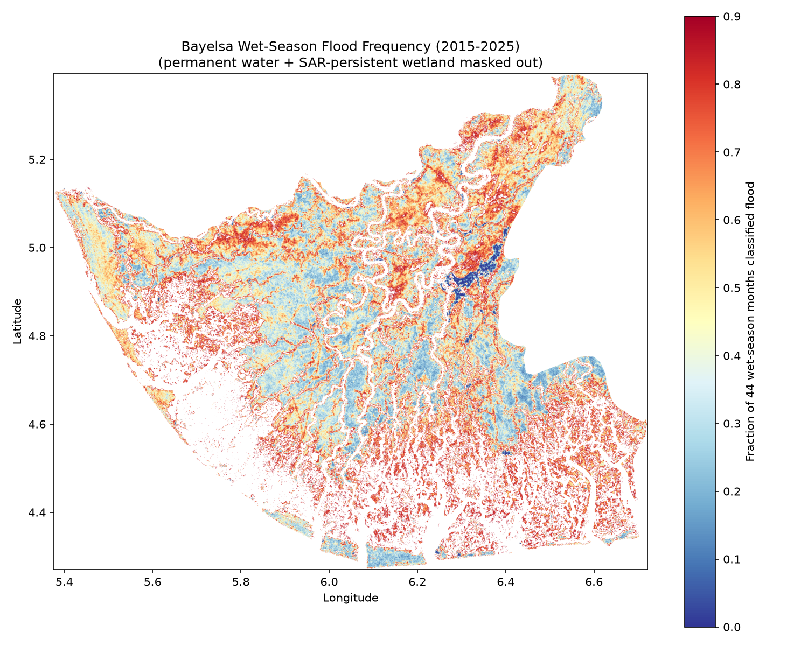
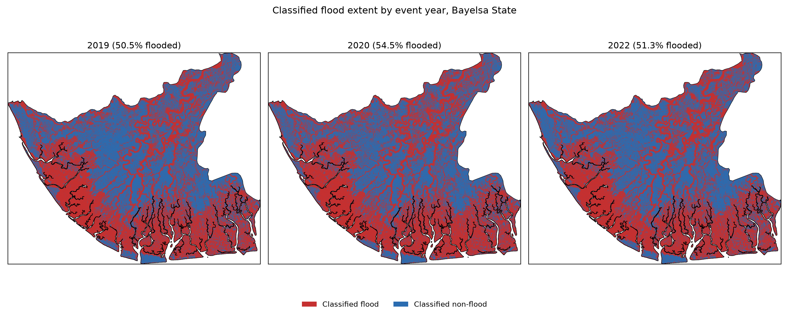
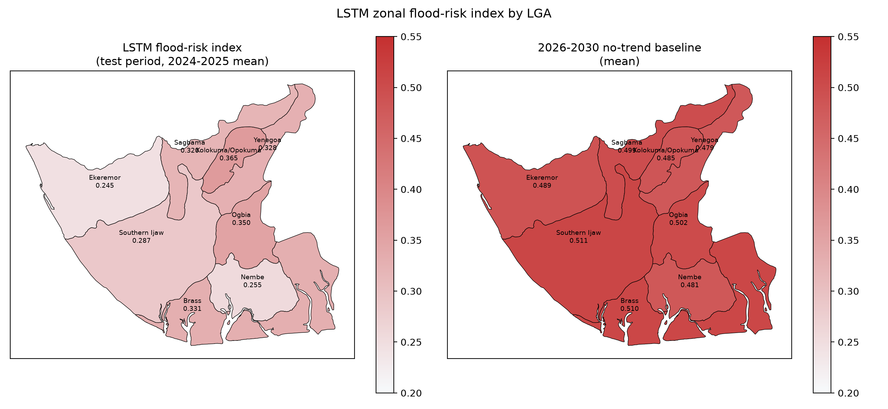
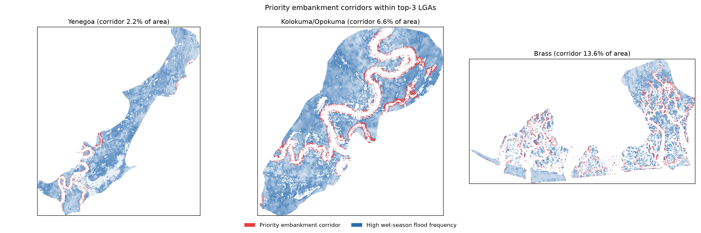

# Sentinel-1 SAR + ML Flood Mapping and Prediction — Bayelsa State, Nigeria

An end-to-end remote-sensing + ML pipeline that maps, explains, and forecasts flood risk across Bayelsa State (~9,807 km², Niger Delta) using Sentinel-1 SAR imagery, a Random Forest classifier, an LSTM forecaster, and multi-source validation — built toward a submission-ready research paper (`PAPER_DRAFT.md`).

## Why this is hard

Standard SAR flood mapping assumes flooding shows up as a drop in radar backscatter (open water is smooth, so it reflects the radar signal away from the sensor). In the Niger Delta's mangrove/swamp forest, the opposite happens: flooded vegetation causes **double-bounce scattering** — the signal bounces off the water surface *and* the tree trunks back to the sensor — so backscatter *increases* during flooding instead of decreasing. A classifier trained only on the textbook "flood = dark" assumption misses most of the real flood extent here. This project's classifier is trained on both signatures explicitly, and that distinction shapes most of the design decisions documented in `PROJECT_PLAN.md`.

## Results

| Component | Headline result |
| --- | --- |
| RF flood classification | 74.6% held-out accuracy, κ = 0.493 (70/30 split, balanced classes) |
| Independent validation (Sentinel-2 NDWI) | 98.0% agreement on open water; lower overall agreement (κ = 0.221) expected, since NDWI structurally can't see flooded-vegetation double-bounce |
| Wet-season flood frequency (2015–2025) | Mean 51.5% of the state classified as flooded in an average wet-season month |
| LSTM backscatter forecasting | MAE 0.116 dB, R² = 0.895 — beats a naive persistence baseline by ~22% |
| Geospatial prioritization | Southern Ijaw, Brass, and Yenagoa rank highest by estimated population in the flood footprint; corridor-level embankment siting within each |

### Flood-frequency map (2015–2025)


### Classified flood extent, documented events


### LSTM zonal flood-risk forecast by LGA


### Priority embankment corridors


## Methodology

1. **SAR processing** — Sentinel-1 GRD IW (VV+VH), Refined Lee speckle filtering, despeckled flood-event/dry-baseline composites.
2. **RF classification + inundation frequency** — feature stack of VV, VH, VH/VV ratio, GLCM texture, DEM/slope, river distance; semi-automated pseudo-labeling from SAR anomaly thresholds; monthly classification aggregated into an 11-year chronic flood-frequency map.
3. **LSTM forecasting** — zonal (LGA-level) monthly VV/VH/rainfall time series, 6-month lookback, chronological train/test split, extended to a flat 2026–2030 climatological baseline and further downscaled to pixel resolution.
4. **Multi-source validation** — Sentinel-2 NDWI cross-check, NEMA/SEMA disaster-record cross-check, Kappa statistics.
5. **Geospatial intelligence** — population-weighted LGA priority ranking (WorldPop 2020) and pixel-level embankment-corridor siting.

Full narrative detail, including every design trade-off, dead end, and fix made along the way, is in `PROJECT_PLAN.md`. The paper itself is `PAPER_DRAFT.md` / `Bayelsa_Flood_SAR_Paper_Draft.docx`. A plain-language index of every script and what it does is in `CODE_SUMMARY.md`.

## Repository structure

```
Flood SAR/
  src/              # reusable modules: SAR processing, feature engineering, classification, GEE utilities
  notebooks/        # phase-by-phase pipeline scripts (not Jupyter notebooks — plain, run-in-order .py scripts)
  data/             # AOI boundary, LGA polygons, RF training samples, LSTM time series
  outputs/
    figures/        # all result figures (tracked)
    tables/         # result tables, CSV (tracked)
    geotiffs/       # classified/forecast raster outputs (regenerated locally, not tracked — see .gitignore)
    models/         # trained LSTM weights (regenerated locally, not tracked)
  PROJECT_PLAN.md               # full project log: methodology, decisions, and why
  PAPER_DRAFT.md                # the paper, in Markdown
  CODE_SUMMARY.md               # one-sentence purpose for every script
  FORECAST_COMPARISON_REPORT.md # 2026–2030 forecast vs. observed, with charts
```

Large/regeneratable binary outputs (raw SAR composites, the consolidated GeoPackage, the trained `.keras` model) are intentionally excluded from version control — see `.gitignore`. They're reproducible by re-running the `notebooks/` scripts, which pull directly from Google Earth Engine.

## Tech stack

Python · Google Earth Engine (`earthengine-api`, `geemap`) · `scikit-learn` (Random Forest) · TensorFlow/Keras (LSTM) · `rasterio` / `geopandas` (geospatial I/O) · QGIS-compatible GeoPackage output.

## Reproducing

```bash
python -m venv venv
venv\Scripts\activate        # Windows
pip install -r requirements.txt
# Authenticate with Earth Engine (one-time): earthengine authenticate
```

Scripts in `notebooks/` are meant to be run in roughly the order they're grouped in `CODE_SUMMARY.md` (Phase 1 → Phase 5) — each one is a standalone `.py` script, not a Jupyter notebook.

## Study scope

Sentinel-1 provides reliable coverage over the Niger Delta from 2015 onward, so all SAR-based analysis anchors on **2015–present**, with 2019, 2020, and 2022 as the primary documented flood-year targets (cross-validated against NEMA/SEMA disaster records). The widely-cited 2012 Nigeria flood predates usable SAR coverage and is used only as background motivation, not as a modeling target.
